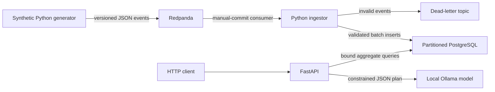

# AI-Queryable Health Data System

[Challenge brief (PDF)](docs/ai-queryable-health-data-system_challenge.pdf)

A small end-to-end system that generates realistic synthetic heart-rate events, streams
them through Redpanda, ingests them idempotently into partitioned PostgreSQL tables, and
exposes safe structured and natural-language aggregate query APIs.

The submission implements the core requirements, Bonus 1, and Bonus 2. The natural-language
layer runs a small local model and requires no API key or paid service.

## Quick start

Prerequisites:

- Docker Engine/Desktop with Compose v2
- At least 4 GB of free Docker memory
- Internet access on first startup to pull container images and the local model
- `curl` and Python 3 for the optional smoke-test script

Start the complete system from this directory:

```bash
docker compose up
```

Compose builds the application image, starts every dependency, seeds seven days of data for
50 users when the stream is empty, then continues emitting live samples. A normal restart
detects the persisted stream and does not seed the historical window again. The API becomes
available after Ollama downloads `qwen2.5:0.5b` on the first run:

- OpenAPI UI: <http://localhost:8000/docs>
- Readiness: <http://localhost:8000/health/ready>
- Prometheus metrics: <http://localhost:8000/metrics>

The API can be ready before the historical replay has finished. Run the smoke test to wait
for data and verify the full path:

```bash
bash scripts/smoke_test.sh
```

Stop the stack with `docker compose down`. To intentionally delete all persisted local data,
use `docker compose down -v`.

## Architecture



All components run in containers:

- `producer` generates a deterministic historical replay, then state-aware live samples.
- `redpanda` provides a durable Kafka-compatible event stream with three partitions.
- `ingestor` validates event schemas, stores batches, commits offsets, and routes invalid data.
- `postgres` persists profiles and time-partitioned measurements and executes queries.
- `ollama` runs `qwen2.5:0.5b` locally and converts questions to validated query plans.
- `api` provides discovery, health, metrics, structured query, and natural-language routes.

## Data model and realism

The system models one metric deeply: `heart_rate_bpm`. Each event contains:

- a deterministic event UUID, schema version, user/device ID, and UTC observation time
- heart-rate value and unit
- `sleep`, `rest`, `active`, or `workout` state
- a synthetic profile: age band, fitness level, resting baseline, and behavior parameters

The default population is 50 users over a rolling seven-day window. Sampling varies by
state: approximately every 10 minutes during sleep, five minutes at rest, two minutes while
active, and 30 seconds during workouts. Twenty-percent timing jitter avoids mechanically
regular series. User-specific baselines depend on fitness and age bands; circadian offsets,
sleep reduction, activity load, workout curves, and state-specific noise shape each value.
Deterministic multi-hour device-off periods create realistic gaps.

This produces roughly 100,000 events on a default laptop-sized run: large enough to exercise
streaming, partitions, and grouped queries while still starting quickly. `GENERATOR_SEED`,
`GENERATOR_USER_COUNT`, and `GENERATOR_HISTORY_DAYS` can be changed in
`docker-compose.yml`.

### Storage shape

`synthetic_users` holds stable profile attributes. `measurements` uses a long-form metric
schema and monthly native PostgreSQL range partitions on `observed_at`. Its primary key is
`(event_id, observed_at)`, satisfying PostgreSQL's partition-key constraint while making an
exact event replay a no-op. Indexes support the expected user/time, metric/time, and
state/time filters.

Long form keeps the event contract extensible for future scalar metrics. A production system
with materially different concepts such as sleep-stage intervals or workouts would add
domain tables rather than force every shape into one generic value column.

## Query API

The API accepts structured analytical intent instead of arbitrary SQL. This provides useful
flexibility without exposing the database to unrestricted statements.

```bash
curl -s http://localhost:8000/v1/query \
  -H 'Content-Type: application/json' \
  -d '{
    "metric": "heart_rate_bpm",
    "user_ids": ["user-0001", "user-0002"],
    "activity_states": ["rest"],
    "aggregation": "avg",
    "granularity": "day",
    "group_by_user": true,
    "limit": 100
  }'
```

Omitted times default to the last 24 hours. Explicit timestamps must include an offset:

```json
{
  "start_time": "2026-10-01T00:00:00Z",
  "end_time": "2026-10-08T00:00:00Z",
  "aggregation": "p95",
  "granularity": "hour",
  "group_by_user": false
}
```

Supported aggregations are `avg`, `min`, `max`, `count`, `p50`, and `p95`; granularities are
`hour` and `day`. Ranges are capped at 31 days, user lists at 100, and output at 5,000 rows.
Metric, aggregation, and granularity are allowlisted. All filter values and limits use
PostgreSQL bind parameters.

Discovery routes:

- `GET /v1/users` lists synthetic profiles and their observation coverage.
- `GET /v1/metrics` lists metric units, time coverage, and row counts.
- `POST /v1/query` returns normalized query metadata and aggregate rows.

Invalid input returns FastAPI's field-level `422` response. An unavailable query engine
returns `503` without leaking database details.

### Natural-language query

`POST /v1/query/natural-language` accepts a question and optional synthetic-user context.
The model emits a constrained JSON plan, never SQL. The same Pydantic validation and
allowlisted SQL builder used by the structured endpoint then execute the plan. The response
contains the interpreted structured query, parameterized SQL, and results. If the small
model returns schema-invalid output for a supported heart-rate question, a deterministic
bounded-intent parser provides a safe fallback through the same query schema.

```bash
curl -s http://localhost:8000/v1/query/natural-language \
  -H 'Content-Type: application/json' \
  -d '{
    "question": "What was my average resting heart rate by day over the last week?",
    "user_id": "user-0001"
  }'
```

Questions outside the available heart-rate data, ambiguous first-person questions without
`user_id`, medical advice, raw-event requests, and ranges over 31 days return `422`.
Model outages return `503`; invalid model output returns `502`.

## Key decisions and tradeoffs

### Streaming ingestion

Redpanda demonstrates the event boundary and decouples generation from storage while using a
single-node, Kafka-compatible container. A direct batch load would use fewer resources, but
would hide offset, replay, backpressure, and invalid-message decisions central to this
exercise. For a tiny embedded deployment, I would remove the broker and load Parquet or
PostgreSQL directly.

The consumer provides at-least-once delivery: it validates a polled batch, commits its
database transaction, publishes invalid records to the DLQ, and only then commits Kafka
offsets. A crash before the offset commit replays the batch; deterministic event IDs and
`ON CONFLICT DO NOTHING` prevent duplicate stored events. Producer idempotence also protects
against retries inside a Kafka session.

### PostgreSQL as storage and query engine

PostgreSQL is operationally familiar, supports constraints and idempotent writes, and is more
than sufficient for this local dataset. Monthly partition pruning and targeted indexes match
the bounded time-series API. ClickHouse would become attractive for billions of append-only
rows and wide scans; object storage plus Parquet/DuckDB would be compelling for cheap batch
analytics. Neither is needed for this workload.

### Constrained local natural language

Ollama avoids paid APIs and keeps synthetic questions local. `qwen2.5:0.5b` keeps the image
practical for laptop evaluation, trading language quality for startup size and latency. The
model can only emit the structured plan schema; it cannot submit SQL. Unsupported questions
have an explicit representation, and every generated plan passes the same range, enum,
user-ID, and result-limit validation as direct API requests. A narrow deterministic fallback
keeps documented heart-rate intents available when the small model produces invalid JSON.

### Intentional limits

- This is synthetic data, not a medical model. Values are plausible, not clinically
  validated, and must not drive health decisions.
- The local API has no authentication or TLS. A real health-data service requires per-user
  authorization, audit logs, encryption, retention/deletion controls, and a formal privacy
  review.
- The demo creates partitions around the current month. Production needs automated
  future-partition creation, retention, backups, and restore testing.
- A single consumer group and database are enough locally. Production sizing requires load
  tests, consumer-lag objectives, connection-pool tuning, and failure drills.
- The small local language model is not a semantic authority. Production use requires a
  versioned evaluation set, model-quality thresholds, prompt-change review, and fallback UX.

## Areas of depth

### 1. Reproducible realism

Randomness is derived from a stable seed plus user/time context rather than process-global
state. The same window reproduces event IDs and values, making failures debuggable and replay
tests meaningful. Tests assert state ordering, physiological bounds, sampling jitter, gaps,
and deterministic output.

### 2. Replay-safe ingestion

The design connects broker acknowledgment to the database transaction, validates every
schema-versioned event, isolates poison records in a DLQ, and enforces identity again in
PostgreSQL. This is intentionally deeper than a fire-and-forget consumer.

Inspect invalid records if testing schema failures:

```bash
docker compose exec redpanda \
  rpk topic consume health-metrics-dlq
```

## Testing and operations

Run fast tests and static checks in the same image used by the services:

```bash
docker compose build api
docker compose run --rm --no-deps api pytest
docker compose run --rm --no-deps api ruff check src tests
```

Run the end-to-end check against a running stack. It covers ingestion, the structured API,
and a real local-model natural-language query:

```bash
bash scripts/smoke_test.sh
```

Structured JSON logs make producer counts, ingestion batches, retries, DLQ events, and query
failures machine-readable. `/metrics` exposes query request counts and latency. A production
version would additionally export broker lag, ingestion latency, DLQ rate, database
saturation, and data-freshness service-level indicators.

## AI usage

AI tooling was used heavily to draft the container scaffolding, generator, ingestion and
natural-language implementations, validation tests, and documentation. Human direction kept
the model behind a constrained query schema instead of allowing model-generated SQL, and
spent the depth budget on realistic data and replay safety. Generated output was checked
against event semantics, the SQL-injection boundary, Kafka commit order, PostgreSQL
partition constraints, and clean-machine startup. A restart test exposed and corrected an
initial design that reseeded a shifted historical window on every producer restart. I would
not trust AI alone to approve clinical realism, privacy controls, threat modeling,
production capacity, model-quality acceptance, or a destructive migration: those require
domain owners, measured evidence, and explicit human accountability.

## If you had two more weeks, what would you build next?

I would add contract and fault-injection tests around broker/database/model outages,
automated partition lifecycle management, end-to-end data-freshness and consumer-lag
telemetry, and authorization scoped to synthetic users. I would also build a versioned
natural-language evaluation suite covering ambiguity, unsupported questions, hallucinated
metrics, relative dates, model upgrades, latency, and fallback-regression behavior.
